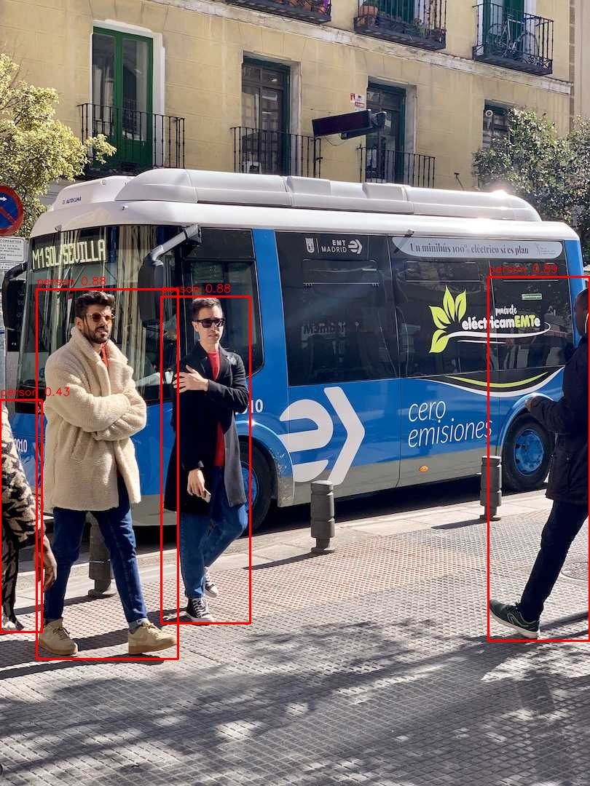

# Orange Pi AI Pro · 昇腾 NPU 推理实验

在一块 Orange Pi AI Pro（昇腾 Ascend 310B4，CANN 8.0.0）上，把三个不同形态的模型
从 PyTorch 一路搬到 NPU 上跑：表格 MLP、影像 CNN、YOLO 检测。
共同链路是 **PyTorch 权重 → ONNX → ATC 编译 → OM → pyACL 推理**。

三个实验的规模差了四个数量级（输入 116 B → 4.9 MB，延迟 0.2 ms → 26 ms），
正好把这条工具链的边界都摸了一遍。



## 结果一览

| 实验 | 任务 | 模型 | OM 体积 | 板端指标 | 延迟 |
|---|---|---|---|---|---|
| 一 | 信用卡欺诈检测 | MLP 29-64-32-1 | 57 KB | AUPRC **0.7764**，与 CPU 基线持平 | **0.207 ms**/条（4,497 条/秒） |
| 二 | 肺炎 X 光分类 | EfficientNet-B0 | 14.6 MB | AUPRC 0.8762，与基线差 0.001 | **7.17 ms**/张 |
| 三 | 人员检测 | YOLOv8n | 7.2 MB | bus.jpg 4/4 人全检出 | 纯推理 **26.4 ms**（37.8 FPS），端到端 16 FPS |

详细数字、逐图得分和阈值分析见 [experiments/实验总结.md](experiments/实验总结.md)，
板上原始产物在 [results/](results/)（指标 JSON + 得分 npz + 检测输出图）。

## 三个印象最深的坑

1. **ONNX 外部权重**。两个原始 onnx 都把权重存成外部 `.data` 文件且没随包提供，
   ATC 直接报 `Failed to get real path`。小模型干脆用 `onnx.helper` 按权重手工构图
   （`build_onnx_mlp.py`），`ReferenceEvaluator` 自校验 diff = 0。
2. **阈值语义**。基线脚本用 `logits[1] - logits[0]` 的原始 logit 差当"分数"，
   无界、可大于 1。误当成概率卡 0.97，F1 会从 0.84 塌到 0.025。
   逐图得分存进 npz 复算才对上：同一尺度下 OM 与基线只差 2 张图。
3. **pyACL 绑定过期**。教程里的手写绑定在板上的 CANN 8.0 里编不过
   （`acl.RT_MEMCPY_HOST_TO_DEVICE` 不存在、`numpy_to_ptr` 已废弃），
   换成官方 `InferSession` 接口重写才通。

## 仓库内容

```
acl_infer_mlp.py        实验一：MLP 板端推理（pyACL）
acl_infer_cnn.py        实验二：CNN 板端推理
acl_detect_yolo.py      实验三：YOLOv8n 板端推理（含后处理）
build_onnx_mlp.py       onnx.helper 手工构图 + ReferenceEvaluator 自校验
exp1_reexport.py        权重内联重导出 ONNX
cam_detect_yolo.py      摄像头帧检测（与 cam_stream_server.py 配套）
cam_stream_server.py    板端 MJPEG 预览服务，浏览器看带框画面
opi_bridge.py           SSH 桥：本地终端直连板子跑命令 / 传文件
opi_sftp.py / opi_download.py / opi_exec.py   板端文件批量拉取与命令执行
start_stream.sh / stop_stream.sh              摄像头流启停
摄像头操作手册.md        从插电到浏览器出画的完整操作记录
experiments/            实验总结、踩坑根因分析、数据契约、讲解稿
results/                板上跑出来的指标 JSON、逐图得分、检测输出图
```

## 怎么跑

前置：板子刷好 CANN 8.0.0 固件，与本机同一局域网。
复制 `opi_config.example.json` 为 `opi_config.json`，填板子地址和密码（或改用密钥）。

```bash
# 编译 OM（板上或装有 CANN 的机器上）
atc --model=mlp_fraud_inline.onnx --input_shape=input:1,29 --soc_version=Ascend310B4

# 板端推理
python acl_infer_mlp.py      # 实验一，56,961 条约 12.7 秒
python acl_infer_cnn.py      # 实验二
python acl_detect_yolo.py    # 实验三，默认跑 bus.jpg

# 摄像头实时预览（板端）
bash start_stream.sh         # 浏览器打开板子 IP:8000
```

数据与模型权重不在仓库里（`downloads/` 是从板子拉回的完整归档，约 300MB，见
`experiments/` 里的说明自行准备数据集）。

## 已知边界

- 端到端 16 FPS 的瓶颈在 Python 侧串行采集与后处理，NPU 本身还有余量；上多线程取帧可以再提
- 只实测了 Ascend310B4 + CANN 8.0.0 这一版组合
- 脚本里的路径按板端 `/home/HwHiAiUser/exp/` 约定写死，换目录要改

## License

MIT
